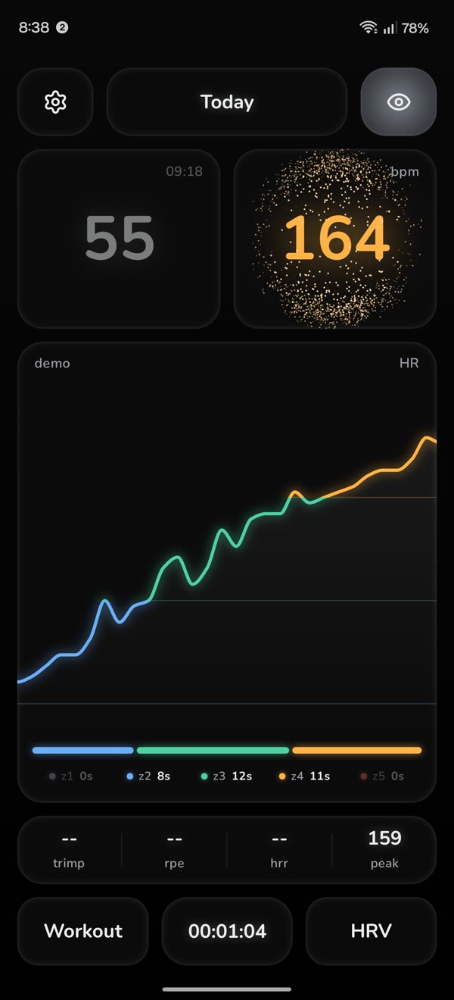
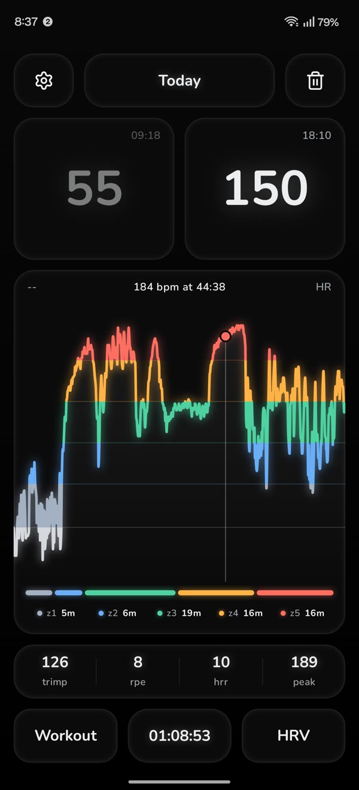
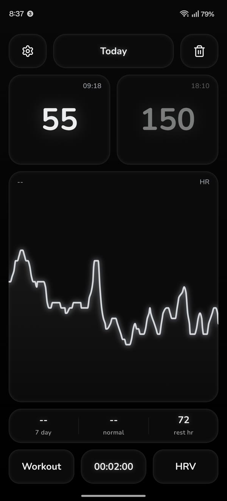
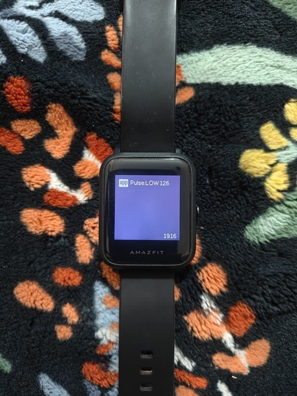

# Pulse

https://github.com/user-attachments/assets/46a115dc-a9e9-4764-a0e3-95701bb7dd6e

| live | workout | HRV check | alert on my wrist |
| :---: | :---: | :---: | :---: |
|  |  |  |  |

my own heart rate app for my Polar H9. no account, no cloud, nothing leaves my phone. every workout and morning HRV check gets saved as a note in my own folder.

could've just bought a fitness band or watch, but the decent ones start around ₹9k (like the Bip Max), wrist HR is nowhere near as accurate as a chest strap, i didn't want the extra features or the bulky look, and i'd be stuck with their app. with this, when my HR goes above or below the range i set, i get a buzz like "HIGH 177" or "LOW 127" on any cheap watch, or a ping in my earphones while working out. only thing i'd miss is sleep tracking, and i have my doubts about its accuracy anyway.

made it cause the Polar app looked pretty bad and i wanted my data with me.

## what it does

- live HR with zones. the sphere spins faster and shakes harder the harder i go
- workouts: time in each zone, TRIMP, RPE, HR recovery and peak
- 2 min HRV check in the morning, compared to my 7 day normal
- HR alerts when i go above or below my range, they buzz on my old Amazfit Bip through Gadgetbridge
- every session saved as markdown + csv, so it shows up in my notes
- works with any Bluetooth HR strap

## code

still reviewing it, will push soon.
